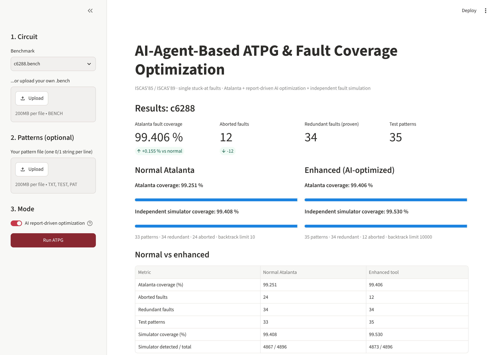

# AI-Agent-Based ATPG and Fault Coverage Optimization

Automatic test pattern generation (ATPG) for **any ISCAS'85 / ISCAS'89
benchmark circuit**, with an AI agent that reads each Atalanta report and
re-runs the ATPG to improve fault coverage, an independent fault simulator
that grades **test patterns read from a file**, and **redundant-fault
reporting**. Includes a web GUI with coverage percentages and charts.

Course project: VLSI Testing & Testability, IIIT Sri City (November 2026).
Author: Madaka Chaithanya Nanda Kumar.



## What it does

| Step | File | What happens |
|---|---|---|
| 1. Scan conversion | `tool_scan_convert.py` | Atalanta rejects circuits with flip-flops. Each DFF is full-scan converted: its output becomes a pseudo primary input, its input a pseudo primary output. |
| 2. ATPG | `tool_atpg.py` | Runs Atalanta, writes `output/<name>.test` and `.log`, parses coverage, redundant, aborted and collapsed faults. |
| 3. AI optimization | `tool_optimize.py` | Reads each report. While faults are *aborted*, re-runs with a 10x larger backtrack limit (10 → 100 → 1000 → 10000), stops when nothing improves, keeps the best run. |
| 4. Fault simulation | `tool_fault_sim.py` | Independent bit-parallel single stuck-at simulator. Grades any pattern file (Atalanta `.test` or hand-written 0/1 lines) and lists undetected faults. |
| 5. Report | `run_dft.py`, `app.py` | Command line or web GUI. |

## Results (normal Atalanta vs this tool)

| Circuit | Normal Atalanta | This tool |
|---|---|---|
| c17 | 100 %, 7 patterns | 100 %, simulator confirms 22/22 |
| c17, own 3-pattern file | not possible | 81.818 %, 4 missed faults listed |
| s298 (14 DFFs) | rejected: flip-flop exists | scan-converted, 100 %, 272/272 |
| c6288 | 99.251 %, 24 aborted | **99.406 %, 12 aborted** (simulator 99.53 %) |
| c6288 redundant | 34 (in the log) | 34, plus saved undetected list |
| my_test.bench (custom) | rejected | finds the planted redundant fault `t1/SA0` |

## Setup (Linux, or WSL Ubuntu on Windows)

```bash
sudo apt install -y git build-essential python3 python3-venv
# Atalanta (not bundled - Virginia Tech, teaching/research use)
git clone https://github.com/hsluoyz/atalanta.git ~/Atalanta && (cd ~/Atalanta && make)

git clone https://github.com/ChaithuRog/ai-atpg-dft-agent.git && cd ai-atpg-dft-agent
python3 -m venv venv && source venv/bin/activate
pip install -r requirements.txt
```

## Run

```bash
# web GUI (open the printed http://localhost:8501 in your browser)
streamlit run app.py

# command line
python run_dft.py benchmarks/c17.bench
python run_dft.py benchmarks/s298.bench                       # ISCAS'89, scan-converted
python run_dft.py benchmarks/c6288.bench --optimize           # AI report-driven optimization
python run_dft.py benchmarks/my_test.bench --patterns benchmarks/my_test_patterns.txt --skip-atpg
```

Pattern file format: one pattern per line, a string of `0`/`1`, character j =
scan input j in `INPUT()` order (primary inputs first, then one bit per
flip-flop). Lines starting with `*` or `#` are ignored; Atalanta `.test`
files work as they are.

## Limitations

- ISCAS'89 circuits use the full-scan assumption; faults inside the scan
  chain are not modelled.
- Atalanta's coverage is on its collapsed fault list; the simulator uses
  stem stuck-at faults on every signal. The two agree on which faults stay
  undetected.

## Credits

- **Atalanta** ATPG: H. K. Lee and D. S. Ha, Virginia Tech (external tool, not
  included; teaching and research use).
- Inspired by the open-source **DFTAgent** project
  (github.com/ame-shiro/DFTAgent), which wraps Atalanta in an LLM chat agent.
  No DFTAgent code is included here.
- ISCAS'85 / ISCAS'89 benchmark circuits (F. Brglez et al.) in `benchmarks/`;
  `my_test.bench` is an original test circuit.
- Code written with AI assistance (Claude).
